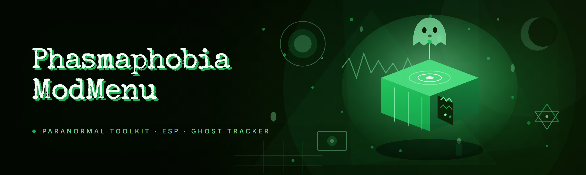

  
  
  

  

  
  

---

Phasmo modmenu: ghost ESP, fullbright, sanity/evidence readout, ghost-type guesser, teleport-to-ghost keybinds

## Overview

Phasmo modmenu: ghost ESP, fullbright, sanity/evidence readout, ghost-type guesser, teleport-to-ghost keybinds

  

## License

[MIT License](LICENSE)

  

